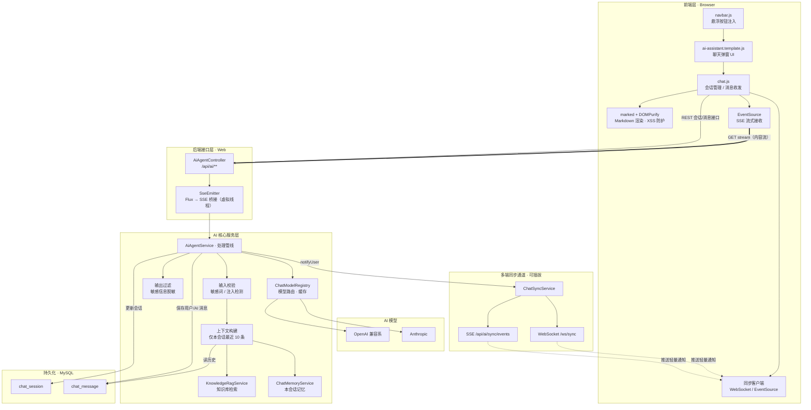
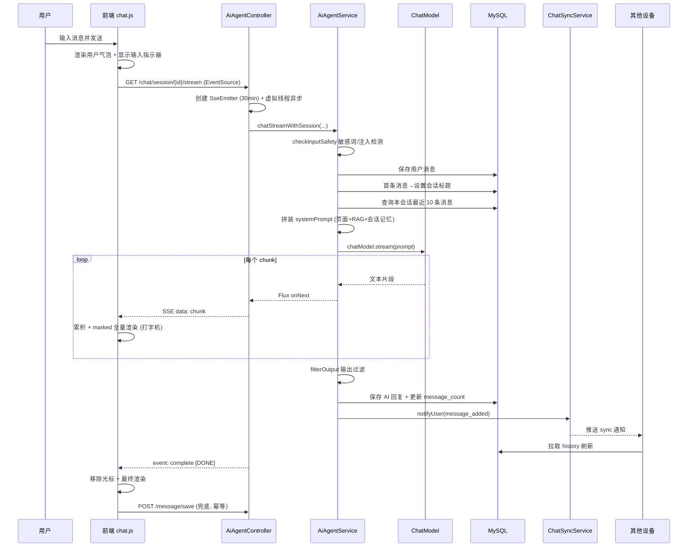

## AI 智能助手 · 一次会话的完整流程

> 适用范围：Brief-Wisdom 项目 AI 智能助手（悬浮聊天窗）
> 整理日期：2026-07-24
> 技术栈：Spring Boot 4 / Java 21（虚拟线程）/ Spring AI 2.0 / MyBatis-Plus / SSE + WebSocket

本文按时间顺序拆解"用户从打开助手到完成一轮对话"的完整链路，分为六个阶段：初始化加载 → 会话管理 → 发送消息 → 后端处理管线 → 流式响应与渲染 → 持久化与多端同步。文末附核心时序图与接口速查表。

---

### 一、整体架构

聊天功能由"前端单页逻辑 + 后端分层服务 + 双通道实时同步"三部分构成。整体架构如下图所示：



> 图中粗实线（`==>`）为聊天内容流，始终走 SSE；虚线（`-.->`）为多端同步通知通道，可插拔为 WebSocket 或 SSE，两者职责分离、互不干扰。

| 层 | 关键文件 | 职责 |
|---|---|---|
| 前端 UI 注入 | `js/navbar.js`、`components/ai-assistant.template.js` | 注入悬浮按钮与聊天弹窗，动态加载 chat.js / marked / DOMPurify |
| 前端聊天逻辑 | `js/chat.js`（约 2192 行） | 会话管理、消息发送、SSE 流式接收、多端同步 |
| 后端接口 | `ai/controller/AiAgentController.java` | `/api/ai/**` 全部接口，SSE 桥接 |
| 后端核心 | `ai/service/AiAgentService.java` | 上下文构建、记忆/RAG 注入、工具调用、模型路由 |
| 实时同步 | `ChatSyncService`（SSE / WebSocket 双实现） | 向同一用户的所有在线设备推送变更通知 |
| 持久化 | `chat_session` / `chat_message` 表 | 会话与消息存储（逻辑删除） |

两个关键配置开关（`application.yml`）：

- `app.chat.streaming: true` —— 聊天模式开关，当前为 true。该开关由 `GET /api/ai/chat/config` 回报给前端，只决定前端走 SSE 流式接口还是一次性返回的同步接口；服务端两条路径都按 Token 增量输出（见「阶段四」第 8 步）。
- `app.sync.transport: websocket` —— 多端同步通道，当前为 websocket（端点 `/ws/sync`），可切换为 sse。

一个重要安全设计：**前端从不传递 userId**。用户身份完全由后端 `UserContextHolder.getCurrentUserId()` 从 HTTP Session 解析，三级回退为：登录用户（Session）→ Spring Security 上下文 → 访客指纹（`guest-` + IP/浏览器/设备哈希）。因此未登录访客也能使用，且同设备 userId 恒定。

---

### 二、阶段一：打开助手与初始化加载

用户点击右下角悬浮按钮 🤖（`#aiFab`），触发 `toggleChat()`（chat.js:213）。首次打开时按顺序懒加载配置与数据：

1. `loadPaginationConfig()` → `GET /api/ai/config/pagination`，获取会话列表与历史消息的分页大小。
2. `loadChatConfig()` → `GET /api/ai/config/chat`，读取 `streaming` 标志，决定后续走流式还是普通模式。
3. `loadModels()` → `GET /api/ai/models/enabled`，拉取可用模型列表渲染模型选择器；`isActive=1` 的为默认选中，`thinkingMode=thinking` 的模型名后加 🧠 标记。
4. `loadSessions()` → `POST /api/ai/sessions`（body `{page, size}`），分页加载会话列表，返回 `PageResult<SessionMetaDTO>`。
5. `connectSync()` → 建立多端同步长连接（见阶段六）。

会话列表支持触底自动加载更多（滚动监听 + `hasMore` 标志）。值得注意的是，**打开助手不会自动创建会话**，仅显示欢迎界面，会话在用户发出第一条消息时才惰性创建。

---

### 三、阶段二：会话管理（创建 / 切换 / 重命名 / 删除 / 导出）

| 操作 | 前端函数 | 接口 | 说明 |
|---|---|---|---|
| 新建 | `createNewSession()` | `POST /api/ai/session`（body `{pageContext}`） | 返回 sessionId 字符串；`pageContext` 为当前页面路径 |
| 切换 | `selectSession()` | `POST /api/ai/session/{id}/history` | 无专用切换接口，切换即加载该会话历史 |
| 重命名 | `startEditSessionTitle()` | `PUT /api/ai/session/{id}/title`（body `{title}`） | 双击标题进入编辑态 |
| 删除 | `deleteSession()` | `DELETE /api/ai/session/{id}` | 先弹自定义确认框；后端逻辑删除 |
| 导出 | `exportSession()` | `GET /api/ai/session/{id}/export` | 返回 Markdown 附件（`Content-Disposition`），前端 Blob 下载 |

新建会话后前端**不手动插入列表**，而是等待多端同步的 `session_created` 事件触发列表刷新，避免重复添加。`pageContext`（即 `window.location.pathname`）用于在会话列表显示来源页面图标（如 `/about.html`→👤 个人简历），并作为上下文传给后端。

---

### 四、阶段三：发送消息

用户在输入框按 Enter（Ctrl+Enter 换行，↑/↓ 浏览发送历史）或点击发送按钮，触发 `sendMessage()`（chat.js:1208）。流程为：防重复标志 `isSending` 校验 → 无会话则先惰性创建 → 立即渲染用户消息气泡（`addMessage(text, "user")`，用 `textContent` 天然防 XSS）→ 清空并禁用输入框 → 显示"正在输入"指示器 → 按 `streaming` 标志分流。

**普通模式** `sendMessageNormal()`：`POST /api/ai/chat/session/{sessionId}`，body `{message, model, pageContext}`，一次性返回完整回复文本。

**流式模式** `sendMessageStream()`（默认）：由于浏览器原生 `EventSource` 只支持 GET，参数全部走 query string：

```
GET /api/ai/chat/session/{sessionId}/stream?message=<编码>&model=<编码>&pageContext=<编码>
```

前端先创建一个带打字光标 `|` 的空 AI 气泡，再用 `new EventSource(url)` 接收增量内容。

---

### 五、阶段四：后端处理管线（核心）

流式请求进入 `AiAgentController.chatStreamWithSession`（L110）。Controller 创建一个 30 分钟超时的 `SseEmitter`，然后在**虚拟线程**（`Executors.newVirtualThreadPerTaskExecutor()`）中异步订阅服务层返回的 `Flux<String>`，把每个 chunk 桥接为 SSE 事件推给前端。

服务层 `AiAgentService.chatStreamWithSession` 的处理管线如下：

1. **输入安全校验** `checkInputSafety`：敏感词检测 + 提示词注入检测。命中则落库拦截记录、写审计日志，并通过 SSE `error` 事件返回 `CONTENT_BLOCKED`。
2. **校验会话归属**：确认会话存在且属于当前用户。
3. **保存用户消息**：写入 `chat_message`（role=user）。
4. **首条消息设标题**：若是会话第一条消息，用其内容截断作为会话标题。
5. **构建上下文**：取本会话最近 10 条消息（`findRecentMessages`）作为对话历史。注意上下文**只含当前会话自身**的消息，不注入其他会话，确保会话间隔离。
6. **拼装系统提示词**：在基础提示词上依次叠加 —— 页面上下文（`getSystemPromptWithContext`）、知识库 RAG 检索结果（`knowledgeRagService`，基于当前消息检索相关文档）、当前会话记忆（`chatMemoryService.buildMemoryContext(userId, sessionId)`，仅本会话记忆）。
7. **模型路由**：`chatModelRegistry.getChatModel(provider, model, thinkingMode)`，按 `provider:model[:thinking]` 缓存键惰性创建 ChatModel（OpenAI 兼容系 / Anthropic）。
8. **调用模型**，两条路径都以 `chatModel.stream()` 逐 Token 输出：
   - **有工具**（当前恒成立，12 个工具由 `ToolConfig` 注册）：`AiAgentService.streamToolRound` 递归循环（最多 5 轮）。每轮用 `stream()` 请求模型 —— Spring AI 2.0 的 `OpenAiChatModel.internalStream` 会把工具调用分片聚合成一条带 `toolCalls` 的响应，而文本分片逐条下发；因此工具轮不产生可见文本，由 `executeToolCalls` 执行工具、把 `AssistantMessage` + `ToolResponseMessage` 追加到消息列表后进入下一轮，模型不再请求工具时该轮文本实时下发。
   - **无工具**：`buildChatOptions(provider, model, false)` 不带工具回调，`chatModel.stream()` 逐 chunk 输出。
9. **输出过滤** `filterOutput`：将身份证/手机号/银行卡等正则替换为 `[敏感信息已过滤]`。**只作用于「无工具」路径服务端落库的副本**；流式分片下发前无法整体正则替换，逐 chunk 过滤会截断敏感串，故明文分片直接透传（改造前「有工具」路径是先过滤整段再下发，这是本次改造唯一的对外行为变化）。
10. **保存 AI 回复**：「无工具」路径在 `doOnComplete` 中用真实 Token 用量（或按 3 字符≈1 token 估算）保存 AI 消息并更新会话 `message_count`；「有工具」路径不服务端落库，消息由前端 `/message/save` 保存，`doOnComplete` 只触发 `notifyUser(message_added)`。

同步接口（普通模式）走 `chatWithSession`，逻辑类似但额外带 2 次重试退避（401/402/403 不重试），且一次性返回完整文本。

---

### 六、阶段五：流式响应与前端渲染

后端通过 SSE 命名事件传递语义，前端 `EventSource` 分别监听：

| SSE 事件 | data 内容 | 前端处理 |
|---|---|---|
| 默认 `message` | 增量文本 chunk（一个 chunk 对应模型返回的一段 Token） | 累积全文 + marked **全量重渲染** + 尾部光标（打字机效果） |
| `complete` | `[DONE]` | 关闭连接、移除光标做最终渲染、触发兜底保存 |
| `stopped` | `[STOPPED]` | 标记"已停止生成"，保留并保存已生成部分 |
| `error` | `{type, message}` JSON | `CONTENT_BLOCKED` 渲染友好错误提示 |

打字机效果的本质是：每收到一个 chunk 就用 `marked.parse()` 对累积全文重新渲染，并经 `DOMPurify.sanitize()` 防 XSS（项目未引入代码高亮库，代码块为原生 `<pre><code>`）。

> **实现现状（2026-11-10 更新）**：此前 12 个 AI 工具通过 `ToolConfig` 恒常注册，`hasTools` 恒为 true，流式请求始终走「`chatModel.call()` 手动循环 → `Flux.just(全文)`」的伪流式分支。现已改造为 `AiAgentService.streamToolRound` 逐轮换用 `chatModel.stream()`：工具轮聚合执行、不进下游文本流，最终答案的 Token 增量实时下发（`brief-wisdom-ai` 的 `AiAgentServiceStreamToolRoundTest` 覆盖分片数量与多轮工具行为）。SSE 通道、停止生成、`complete` / `stopped` / `error` 命名事件均为真实实现。

**停止生成**：用户点停止按钮 → `stopStreaming()` 置 `isUserStopped=true`、关闭 EventSource、调用 `DELETE /api/ai/chat/stream/stop`。后端从 `activeStreamSubscriptions`（`Map<userId, Disposable>`）取出该用户的 Reactor 订阅并 `dispose()`，Flux 收到取消异常后走 `stopped` 分支。

---

### 七、阶段六：持久化与多端同步

**消息持久化（双保险）**：流式 AI 消息由**服务端**在 `doOnComplete` 中保存（含真实 Token 信息）；前端在收到 `complete` 后也会调 `POST /api/ai/message/save` 兜底，但服务层有**幂等检查**（末条 assistant 消息内容相同则跳过，仅补 Token），避免重复落库。若服务端保存失败，则由前端兜底生效。

**多端实时同步**：`ChatSyncService.notifyUser(userId, eventType, sessionId)` 向该用户所有在线设备推送轻量通知（只推 `{type, sessionId}`，不推消息体）。事件类型有三种：`session_created`、`session_deleted`、`message_added`。

- 当前配置走 **WebSocket**（`/ws/sync`，握手复用 HTTP Session 登录态，30s 心跳）。
- 备选 **SSE**（`/api/ai/sync/events`，`matchIfMissing` 兜底）。

前端 `handleSyncEvent` 收到通知后自行拉取数据刷新：`session_created/deleted` → 重载会话列表；`message_added` → 刷新列表，若是当前会话则重载历史消息。此外还有 `GET /api/ai/sync/status` 轮询指纹（fingerprint）作为同步兜底。

---

### 八、核心时序图



---

### 九、接口速查表

| 接口 | Method | 用途 |
|---|---|---|
| `/api/ai/config/pagination` | GET | 分页配置 |
| `/api/ai/config/chat` | GET | 流式开关 |
| `/api/ai/models/enabled` | GET | 可用模型列表 |
| `/api/ai/sessions` | POST | 会话列表（分页） |
| `/api/ai/session` | POST | 新建会话 |
| `/api/ai/session/{id}` | DELETE | 删除会话 |
| `/api/ai/session/{id}/title` | PUT | 重命名会话 |
| `/api/ai/session/{id}/history` | POST | 消息历史（分页） |
| `/api/ai/session/{id}/export` | GET | 导出 Markdown |
| `/api/ai/chat/session/{id}` | POST | 同步聊天 |
| `/api/ai/chat/session/{id}/stream` | GET(SSE) | 流式聊天 |
| `/api/ai/chat/stream/stop` | DELETE | 停止生成 |
| `/api/ai/message/save` | POST | 流式消息兜底保存 |
| `/api/ai/sync/transport` | GET | 同步通道探测 |
| `/api/ai/sync/events` | GET(SSE)/DELETE | SSE 同步通道 |
| `/api/ai/sync/status` | GET | 同步状态轮询兜底 |
| `/ws/sync` | WebSocket | WebSocket 同步通道 |

---

### 十、关键设计要点

聊天内容流走 SSE（`SseEmitter` 桥接 `Flux<String>`；当前文本粒度为整段，见「阶段六」现状说明），而多端同步通知是可插拔的独立通道（SSE 或 WebSocket），两者职责分离、互不干扰。流式接口用 GET 仅为兼容浏览器原生 `EventSource`。

会话隔离是核心约束：每个会话的 AI 上下文只包含本会话自身的最近消息与本会话记忆，不会拉取同一用户其他会话的记录或记忆，从根本上避免上下文串扰。

身份解析完全在后端完成，前端不传 userId，既简化了接口也避免了越权风险；未登录访客以设备指纹获得稳定 userId。流式消息采用"服务端保存为主、前端兜底 + 幂等检查"的双保险，兼顾 Token 信息完整性与可靠性。横切能力（输入/输出内容过滤、审计、模型路由、重试）穿插在管线各节点，限流能力已实现但当前聊天链路未启用。
