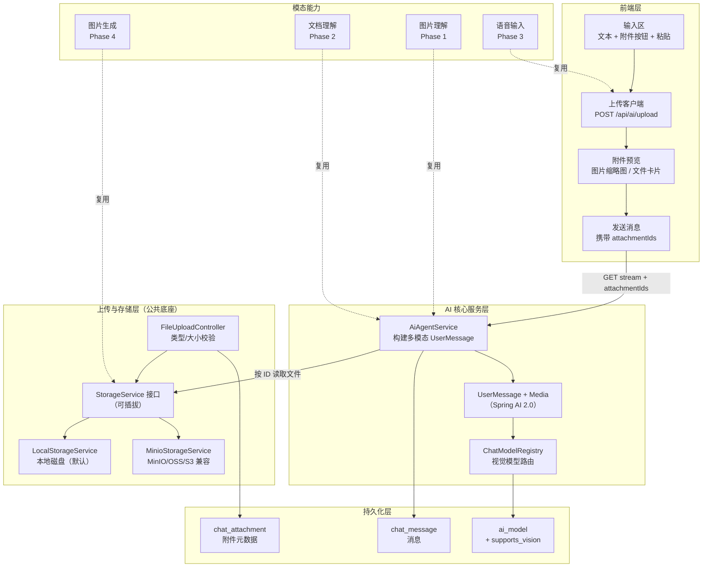

# 多模态能力设计方案

> 适用范围：Brief-Wisdom 项目 AI 智能助手
> 整理日期：2026-07-25
> 技术栈：Spring Boot 4 / Java 21（虚拟线程）/ Spring AI 2.0 / MyBatis-Plus / Flyway / Redis / SSE + WebSocket

本方案规划为 AI 智能助手扩展多模态能力，覆盖**图片理解、文档理解、语音输入、图片生成**四类，统一采用**对象存储（MinIO/OSS/S3 兼容）**。为降低风险，采用「先打公共底座、再逐项扩展」的分阶段实施策略：所有模态都复用同一套存储抽象、文件上传与附件数据模型。

---

## 一、背景与现状

当前 AI 助手是**纯文本**对话，多模态能力为空白。调研结论如下：

| 维度 | 现状 |
|---|---|
| 数据模型 | `chat_message` 无附件字段；`message_type` 预留了 `image` 但从未赋值（`AiAgentService.MESSAGE_TYPE_TEXT = "text"`） |
| AI 调用层 | 仅用纯文本 `new UserMessage(context.toString())`，未使用 Spring AI 2.0 的 `Media` 多模态 API |
| 模型能力标记 | `ai_model` 表无视觉/多模态标记字段 |
| 文件上传/存储 | 完全不存在（无 MultipartFile 接口、无存储 Service、无 OSS/MinIO 配置） |
| 文档解析 | 仅 `MarkdownImportService` 读取本地 `.md`，无 PDF/Word 解析能力 |
| 前端 | 纯文本输入框，无上传 UI；流式走 GET `EventSource`，**无法携带文件二进制** |
| Spring AI 版本 | 2.0.0 已原生支持 `UserMessage + Media`，但项目未使用 |

关键约束：流式接口 `GET /api/ai/chat/session/{id}/stream` 通过 query string 传参（浏览器原生 `EventSource` 仅支持 GET），因此**不能在发送消息时直接携带文件**。本方案采用「**上传先行（upload-first）**」规避：先把文件上传到存储拿到 `attachmentId`，再把 ID 随消息发送，后端按 ID 从存储读取文件构造多模态消息。这样无需改动流式 SSE 架构。

---

## 二、总体架构



核心设计原则：

1. **存储可插拔**：仿照项目已有的 `ChatSyncService`（sse/websocket 可切换）模式，定义 `StorageService` 接口，通过 `app.storage.type` 在 `local` 与 `minio` 间切换。默认 `local`，保证无对象存储环境也能开箱即用；生产切 `minio` 即可对接 MinIO/阿里云 OSS/ AWS S3 等 S3 兼容服务。
2. **上传先行**：文件先上传拿 `attachmentId`，消息只传 ID，规避 GET EventSource 无法携带文件的限制，且天然支持「一条消息多张图」「先传后编辑文案」。
3. **附件元数据持久化**：`chat_attachment` 表记录文件元信息并关联 `session_id` / `message_id`，支持历史回放与多端同步。
4. **模型能力标记**：`ai_model.supports_vision` 标记视觉模型，发送图片时校验或自动切换，避免把图片发给纯文本模型导致报错。

---

## 三、公共底座（Phase 1 地基，所有模态复用）

### 3.1 存储抽象 StorageService

接口定义（`brief-wisdom-ai` 模块 `ai.storage` 包）：

```java
public interface StorageService {
    /** 上传文件，返回存储元信息（key + 可访问 URL） */
    StoredObject upload(InputStream input, String fileName, String contentType, long size);

    /** 按 key 读取文件字节（用于构造 Media 发给模型） */
    byte[] readBytes(String key);

    /** 获取可访问 URL（本地为 /uploads/xxx，对象存储为预签名或公开 URL） */
    String resolveUrl(String key);

    /** 删除文件 */
    void delete(String key);
}
```

配置（`application.yml`，遵循项目 `app.*` 命名空间与可插拔风格）：

```yaml
spring:
  servlet:
    multipart:
      max-file-size: 20MB
      max-request-size: 25MB

app:
  storage:
    type: local                      # local | minio
    local:
      base-dir: ${STORAGE_LOCAL_DIR:./uploads}
      url-prefix: /uploads           # 静态资源映射前缀
    minio:
      endpoint: ${MINIO_ENDPOINT:http://localhost:9000}
      access-key: ${MINIO_ACCESS_KEY:}
      secret-key: ${MINIO_SECRET_KEY:}
      bucket: ${MINIO_BUCKET:brief-wisdom}
      url-expire-seconds: 3600       # 预签名 URL 有效期
```

实现要点：

- `LocalStorageService`：文件落到 `base-dir`（按 `yyyy/MM/dd/uuid.ext` 分目录防冲突），通过 `WebMvcConfigurer` 把 `url-prefix` 映射到本地目录；`readBytes` 直接读本地文件。
- `MinioStorageService`：使用 MinIO Java SDK（S3 兼容，同样适用阿里云 OSS S3 兼容端点与 AWS S3），`upload` 用 `putObject`，`readBytes` 用 `getObject`，`resolveUrl` 返回预签名 URL。
- `StorageConfig`：用 `@ConditionalOnProperty(name = "app.storage.type", havingValue = "local"/"minio")` 装配对应 Bean，与项目同步通道的装配方式一致。

### 3.2 文件上传接口

`FileUploadController`（`/api/ai/upload`，落在已 `permitAll` 的 `/api/ai/**` 前缀下）：

- `POST /api/ai/upload`，接收 `MultipartFile file` + 可选 `category`（image/document/audio）。
- 校验：扩展名/MIME 白名单（图片 jpg/png/gif/webp，文档 pdf/docx/md/txt，音频 wav/mp3/m4a）、大小上限（由 multipart 配置兜底）。
- 调用 `StorageService.upload`，写入 `chat_attachment`（此时 `message_id` 为空，发送消息时回填），返回 `AttachmentDTO`。
- 本地存储需在 `SecurityConfig` 放行 `/uploads/**`。

### 3.3 附件数据模型

`chat_attachment` 表（Flyway `V9__multimodal_attachment.sql`）：

| 字段 | 类型 | 说明 |
|---|---|---|
| id | bigint unsigned PK | 自增主键 |
| user_id | varchar(64) | 上传者 |
| session_id | varchar(64) NULL | 所属会话（发送时回填） |
| message_id | bigint NULL | 所属消息（发送时回填） |
| file_name | varchar(255) | 原始文件名 |
| file_key | varchar(500) | 存储 key |
| file_url | varchar(1000) | 可访问 URL |
| media_type | varchar(100) | MIME 类型 |
| file_size | bigint | 字节数 |
| category | varchar(20) | image / document / audio |
| create_time / update_time / is_deleted | — | 标准三字段 |

配套 `ChatAttachment` 实体（继承 `BaseEntity`）+ `ChatAttachmentMapper` + `ChatAttachmentRepository`（沿用项目 Repository 模式）。`ChatMessageDTO` 增加 `attachments` 字段（`List<AttachmentDTO>`），历史消息接口按 `message_id` 批量回填，前端据此渲染图片/文件卡片。

### 3.4 模型视觉能力标记

- `ai_model` 增加 `supports_vision TINYINT UNSIGNED DEFAULT 0`（同一 V9 迁移）。
- `AiModel` 实体、`AiModelDTO` 增加 `supportsVision` 字段。
- 初始化数据：将 `qwen-vl-max`、`gpt-4o`、`gpt-4o-mini`、`claude-sonnet-4` 等视觉模型 `supports_vision` 置 1。
- 前端模型选择器对视觉模型加 🖼️ 标记；发送图片时若当前模型非视觉模型，提示或自动切换到默认视觉模型。

---

## 四、图片理解（Phase 1 旗舰能力）

后端 `AiAgentService` 改造（`chatWithSession` / `chatStreamWithSession`）：

1. `ChatRequest` 增加 `attachmentIds`（`List<String>`；GET 流式接口用逗号分隔字符串绑定）。
2. 保存用户消息后，把 `attachmentIds` 对应的附件回填 `session_id` / `message_id`。
3. 构建发往模型的 `UserMessage` 时：若本条消息含 `image` 附件，从 `StorageService.readBytes` 读取字节，构造 `Media` 列表，使用 `new UserMessage(text, List<Media>)`（Spring AI 2.0 多模态 API）；纯文本消息保持原样。
4. 模型路由校验：含图片时确认目标模型 `supports_vision = 1`，否则抛出友好异常或回退到默认视觉模型。

前端改造（`navbar.js` 输入区 + `chat.js`）：

- 输入区增加附件按钮 📎 与隐藏 `<input type="file" multiple accept="image/*">`，支持点击选择与 Ctrl+V 粘贴图片。
- 选中图片立即调 `POST /api/ai/upload` 上传，输入框上方显示缩略图预览（可删除）。
- 发送时把已上传附件的 `attachmentIds` 随消息发送（流式拼到 query string）。
- 消息气泡渲染：用户消息含图片时渲染缩略图（点击放大）；历史消息依据 `ChatMessageDTO.attachments` 还原。

---

## 五、文档理解（Phase 2）

复用 Phase 1 的上传与附件模型（`category=document`）。新增文档解析能力：

- 引入 Apache Tika（`tika-parsers-standard-package`）或 Spring AI `DocumentReader`，解析 PDF/Word/Markdown/纯文本为文本。
- 两种注入策略：短文档直接作为上下文注入系统提示词；长文档分块写入知识库向量库（复用 `KnowledgeRagService` 检索），按 RAG 方式召回相关片段。
- `DocumentParseService` 统一封装解析与分块，上传文档时异步解析并缓存文本结果到附件记录。

---

## 六、语音输入（Phase 3）

复用上传与附件模型（`category=audio`）。提供两套方案：

- **方案 A（推荐起步，零后端）**：浏览器 Web Speech API（`webkitSpeechRecognition`）本地识别，识别文本直接填入输入框，用户确认后按普通文本发送。实现成本最低。
- **方案 B（服务端，质量更稳）**：前端录音上传 → 服务端 STT（DashScope paraformer / OpenAI Whisper）转文本 → 回填输入框或直接作为消息发送。需新增 `SpeechToTextService` 与对应模型配置。

---

## 七、图片生成（Phase 4）

- 接入图像生成模型：DashScope `wanx`（通义万相）或 OpenAI Images API（DALL·E / gpt-image）。
- 新增 `ImageGenerationService` 与 `POST /api/ai/image/generate` 接口，输入提示词，返回生成图片 URL。
- 生成的图片可存回 `StorageService` 并登记为附件，在对话中以图片气泡展示，支持下载。
- 该能力为「输出模态」，与前三类「输入模态」独立，复用存储层即可。

---

## 八、数据库与配置变更汇总

数据库（Flyway `V9__multimodal_attachment.sql`）：

1. 创建 `chat_attachment` 表（含 user_id / session_id / message_id 索引）。
2. `ai_model` 增加 `supports_vision` 字段。
3. 初始化视觉模型 `supports_vision = 1`。

配置（`application.yml`）：

1. `spring.servlet.multipart` 文件大小上限。
2. `app.storage.*`（type / local / minio）。
3. `SecurityConfig` 放行 `/uploads/**`（本地存储时）。

依赖（`brief-wisdom-ai/pom.xml`）：

1. Phase 1：MinIO SDK（`io.minio:minio`）。
2. Phase 2：Apache Tika 或 Spring AI 文档解析。
3. Phase 4：图像生成模型对应 starter（如 `spring-ai-starter-model-openai` 已含 images，或 DashScope SDK）。

---

## 九、实施路线图

| 阶段 | 内容 | 复用关系 | 关键产物 |
|---|---|---|---|
| Phase 1 | 公共底座 + 图片理解 | — | StorageService、上传接口、chat_attachment、supports_vision、UserMessage+Media、前端上传 UI |
| Phase 2 | 文档理解 | 复用上传 + 附件模型 | DocumentParseService（Tika）、上下文/RAG 注入 |
| Phase 3 | 语音输入 | 复用上传 + 附件模型 | Web Speech（A）/ SpeechToTextService（B） |
| Phase 4 | 图片生成 | 复用存储层 | ImageGenerationService、生成接口、图片展示 |

---

## 十、风险与注意事项

- **GET EventSource 限制**：已通过 upload-first 规避，消息仅传 attachmentId。
- **视觉模型依赖**：图片理解需启用并正确配置视觉模型 API Key（如 DashScope `qwen-vl-max`），否则发送图片会失败；需在模型路由处做清晰校验与提示。
- **存储一致性**：本地存储不适用于多实例部署（文件不共享），多实例必须切 `minio`。
- **内容安全**：当前输入安全校验针对文本，图片/文档的违禁内容审核为后续增强项。
- **大文件与并发**：上传走虚拟线程，大文档解析建议异步化，避免阻塞主对话链路。
- **编码规范**：所有新增代码须遵循 `AGENTS.md`（命名驼峰、Javadoc 含 @author/@date、SLF4J 占位符、禁魔法值、POJO 布尔不加 is 前缀等）。
